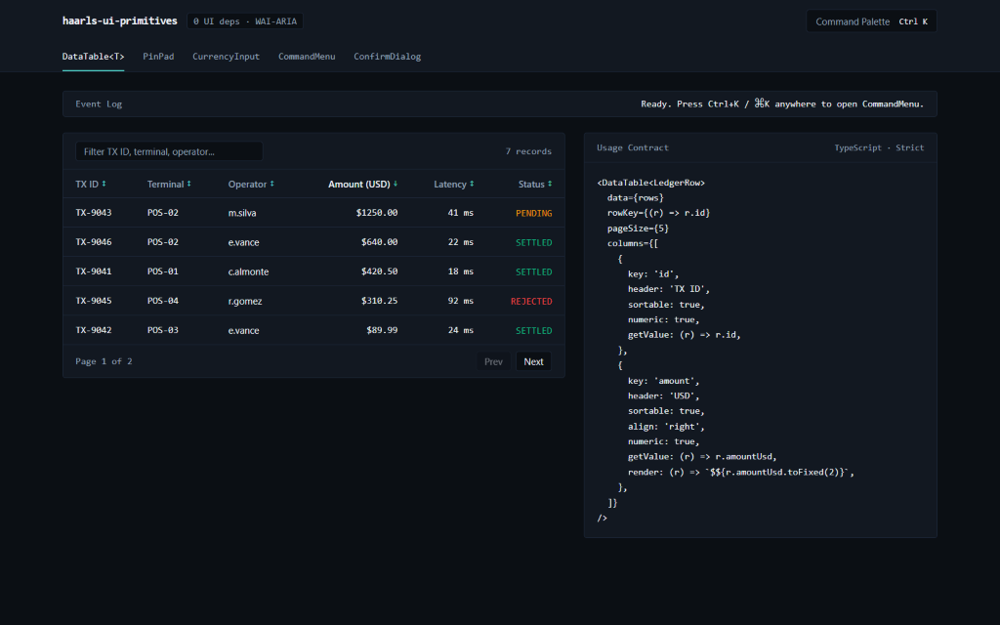
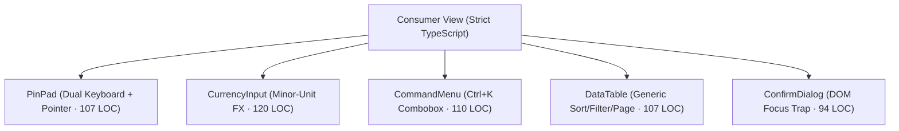

# haarls-ui-primitives

> **Live Demo:** [https://ui.haarls.dev](https://ui.haarls.dev) — Interactive showcase of all 5 zero-dependency WAI-ARIA primitives with live keyboard & focus testing.

Five accessible, strictly typed React + TypeScript UI primitives built from scratch on raw DOM and WAI-ARIA patterns.
Zero component library dependencies (no Radix, no Headless UI, no MUI, no Shadcn), styled with Tailwind CSS v3.4.



## Component Architecture



## Why It's Built This Way

- **Manual DOM Focus Trap & Trigger Restoration (`ConfirmDialog`)**: Queries focusable descendants on `Tab` / `Shift+Tab` to cycle focus inside `role="alertdialog"`, focuses the non-destructive `Cancel` action by default, and captures `document.activeElement` prior to mount so `Escape` or dismissal restores keyboard focus to the exact originating control.
- **WAI-ARIA Combobox + Listbox (`CommandMenu`)**: Registers a global `Ctrl+K` / `⌘K` listener, maintains `aria-activedescendant` across cyclic `ArrowUp` / `ArrowDown` navigation, and filters across `label`, `group`, and `keywords` without losing input focus.
- **Zero-`any` Generic `DataTable<T>`**: Column definitions accept typed accessors `(row: T) => string | number` and optional custom cell renderers, exposing `aria-sort="ascending" | "descending" | "none"` on sortable headers with `tabular-nums` alignment for financial and latency data.
- **Minor-Unit Multi-Currency Input (`CurrencyInput`)**: Rejects malformed or `>2` decimal keystrokes via `/^\d*(\.\d{0,2})?$/` before state updates and converts via integer cents (`Math.round(Math.round(usd * 100) * rate) / 100`) to avoid IEEE-754 rounding drift.
- **Dual-Input Masked `PinPad`**: Handles physical keyboard digits (`0–9`, `Backspace`, `Delete`/`Escape`, `Enter`) alongside pointer clicks on a `role="group"` container with polite `aria-live` progress updates.

## Quick Start (3 Steps)

1. Install dependencies:
   ```powershell
   npm install
   ```

2. Run strict typecheck, production bundle, and Testing Library suite:
   ```powershell
   npm run typecheck
   npm run build
   npm test
   ```

3. Launch the interactive workbench locally:
   ```powershell
   npm run dev
   ```

## Author

Carlos Almonte (**Haarls**) — [haarls.dev](https://haarls.dev) · [carlos@haarls.dev](mailto:carlos@haarls.dev)
